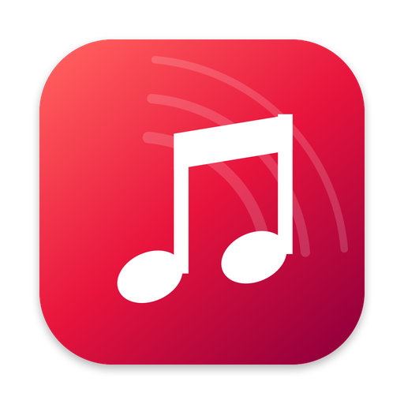
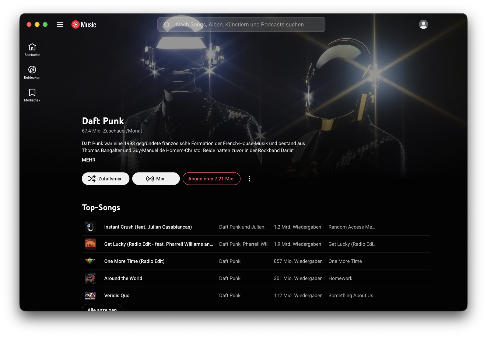
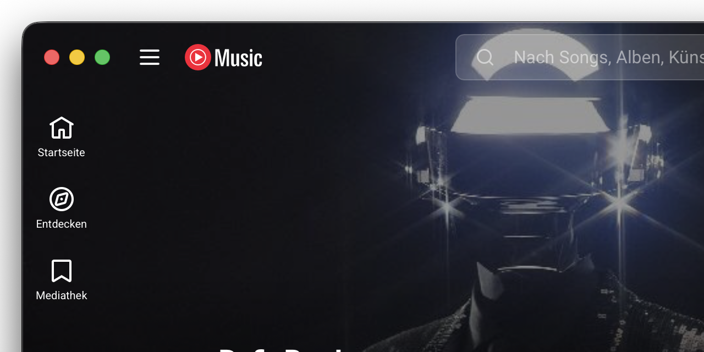
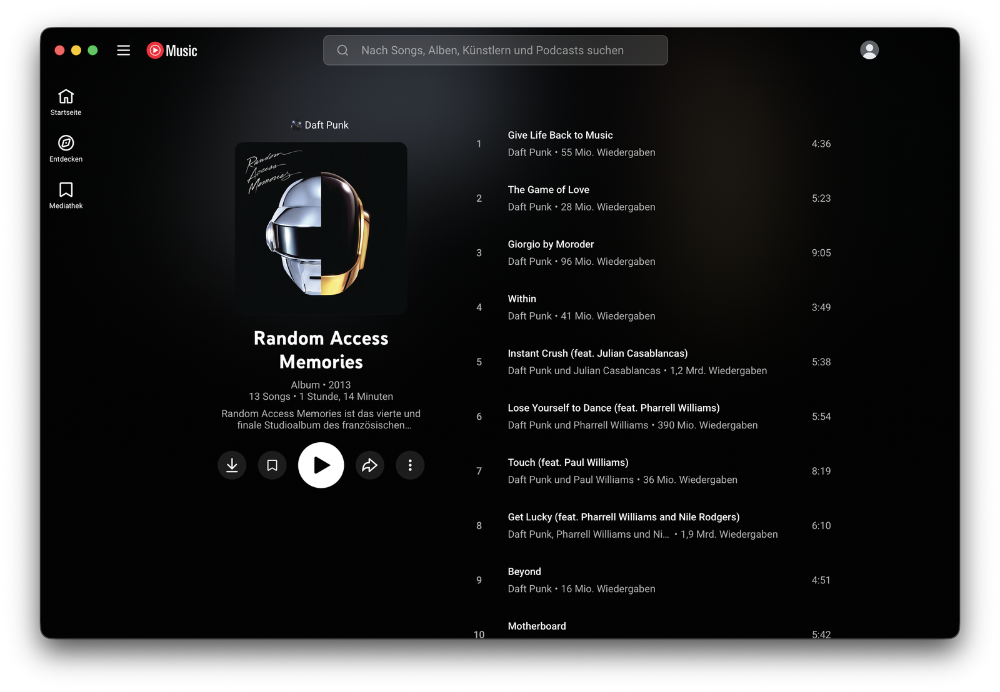
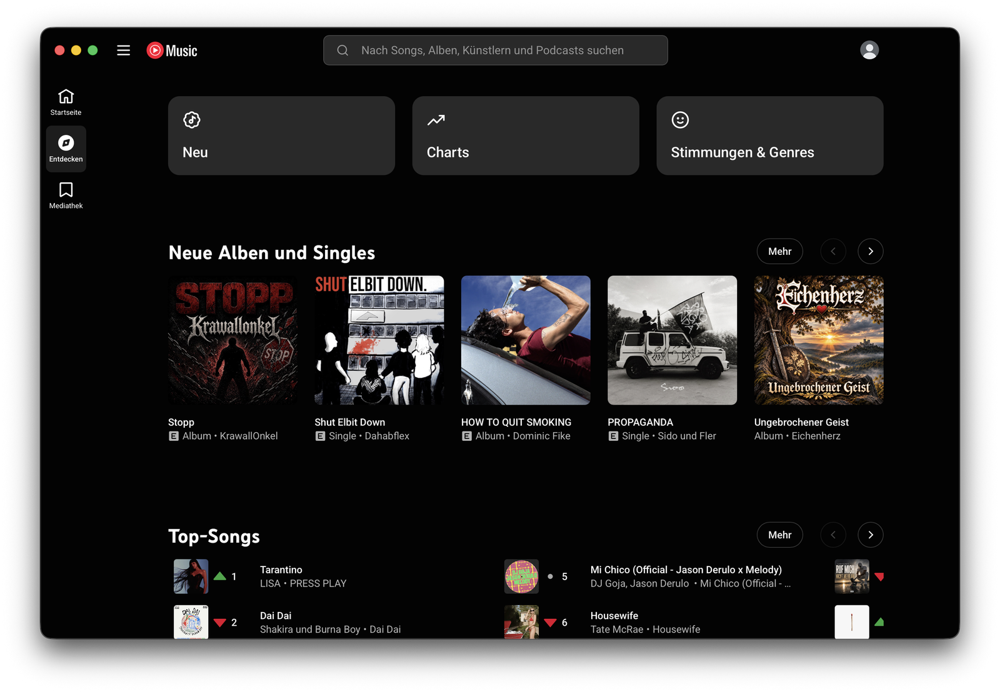

<div align="center">



# Tubemac – the YouTube Music app for Mac

**YouTube Music, finally at home on your Mac.**<br>
A free app that makes YouTube Music look, feel and behave like a real Mac app.<br>
1 MB · Apple Silicon & Intel · macOS 14+ · works with free and Premium accounts

[**⬇ Download for Mac – free**](https://github.com/claudimoret/youtube-music-mac/releases/latest/download/Tubemac.zip) · [Website](https://claudimoret.github.io/youtube-music-mac/) · [Compare apps](https://claudimoret.github.io/youtube-music-mac/how-to-get-youtube-music-on-mac/) · [Deutsch](https://claudimoret.github.io/youtube-music-mac/de/) · [♥ Support](#-support)



</div>

## Is there a YouTube Music app for Mac?

Google doesn't make one – on macOS, YouTube Music officially only runs in a browser tab. **Tubemac** is a free, open-source app that puts the official YouTube Music player into a real Mac window, with media keys, Control Center controls and music that keeps playing when you close the window. It's a 1 MB download for Apple Silicon and Intel Macs running macOS 14 or later.

## Feels like it was made for the Mac



- **Edge to edge.** No browser bar, no grey title strip – artwork runs right up behind the window buttons, which sit in line with the toolbar like in Apple's own apps.
- **Your play button just works.** Media keys, AirPods and the Touch Bar control playback, even from another app.
- **One clean Now Playing.** Control Center shows artwork, back, play/pause, next and a scrubber – no doubled entries, no odd 15-second buttons.
- **Keeps playing.** Close the window, the music goes on. Click the Dock icon to bring it back.
- **The little things.** Centered search, no rubber-band scrolling, drag and double-click the toolbar like a title bar, menus in English or German.
- **Tiny.** 1 MB, built on Apple's own web engine (the one Safari uses) instead of a bundled Chrome.

<p align="center">
  
  
</p>

## How Tubemac compares

| | **Tubemac** | YTMDesktop | Pear Desktop | Kaset | Safari web app |
|---|---|---|---|---|---|
| Made for | **Mac only** | Windows, Mac, Linux | Windows, Mac, Linux | Mac only | Mac |
| Built with | **Apple's web engine** | Electron (bundled Chrome) | Electron (bundled Chrome) | SwiftUI, own interface | Safari |
| Mac download | **1 MB** | 118 MB | 118 MB | 18 MB | built in |
| Works without Premium | **Yes** | Yes | Yes | Premium for full playback | Yes |
| Minimum macOS | **14** | – | – | 15.4 | 14 |
| Stands out with | **Native Mac look, edge-to-edge, tiny** | Discord status, phone remote | Plugins | Apple-Music-like UI, YouTube videos | Passkey sign-in |

<sub>Sizes and versions from each project's latest Mac release on GitHub, checked 8 November 2026. More in the guide: [How to get YouTube Music on Mac – 5 ways compared](https://claudimoret.github.io/youtube-music-mac/how-to-get-youtube-music-on-mac/).</sub>

## Install

1. **[Download Tubemac](https://github.com/claudimoret/youtube-music-mac/releases/latest/download/Tubemac.zip)**, double-click to unzip and drag **Tubemac** into your **Applications** folder.
2. **Allow it once.** Tubemac isn't notarized by Apple, so macOS asks you to confirm the first launch: **System Settings → Privacy & Security → Open Anyway**. (Or in Terminal: `xattr -dr com.apple.quarantine /Applications/Tubemac.app`)
3. **Sign in** with your Google account. On the passkey prompt choose *Try another way → Enter your password* – you only need to do this once.

## FAQ

**Is Tubemac free? Are there ads?** – Free and open source (MIT). Tubemac adds no ads and no tracking. Free YouTube Music accounts see YouTube's usual ads, like in the browser.

**Do I need Premium?** – No, free and Premium accounts both work.

**Why can't I use my passkey?** – macOS only gives passkeys and saved passwords to Safari and apps Google has officially approved. Use your password once.

**Is it safe?** – Tubemac only talks to YouTube Music and Google sign-in. No analytics, no servers of its own. The whole app is one Swift file: [`Sources/main.swift`](Sources/main.swift).

**Keyboard shortcuts?** – ⌘P play/pause · ⌘→ / ⌘← next/previous · ⌘[ / ⌘] back/forward · ⌘R reload · ⌘+ / ⌘− zoom · ⌃⌘F full screen.

## 🇩🇪 Deutsch

**Tubemac ist die kostenlose YouTube Music App für den Mac** – mit eigenem Fenster und Dock-Icon, Mediatasten, sauberem „Läuft gerade“ im Kontrollzentrum und randlosem Mac-Design. 1 MB, Apple Silicon und Intel, ab macOS 14. → [Deutsche Seite](https://claudimoret.github.io/youtube-music-mac/de/)

## ♥ Support

Tubemac is free and made in my spare time. If you enjoy it, a small tip via PayPal is very welcome – totally optional.<br>
*Gefällt dir die App? Über eine kleine Spende freue ich mich – ganz freiwillig.*

[](https://www.paypal.com/paypalme/morrret/1EUR)
[](https://www.paypal.com/paypalme/morrret/2EUR)
[](https://www.paypal.com/paypalme/morrret/5EUR)
[](https://www.paypal.com/paypalme/morrret)

## For developers

```bash
git clone https://github.com/claudimoret/youtube-music-mac.git
cd youtube-music-mac
./build.sh --install     # universal build into /Applications (needs Xcode or Command Line Tools)
```

How it works: a `WKWebView` loads music.youtube.com with a Safari user agent and a persistent data store. A small injected script passes YouTube Music's Media Session to macOS (replacing the ±10 s seek handlers with previous/next/seek-to so Control Center shows Apple-Music-style controls), disables overscroll, centers the search, shifts the nav bar to make room for the traffic lights – which are re-centered in the 64 px nav bar – and turns empty nav bar areas into a window drag region.

## License & disclaimer

MIT License – see [LICENSE](LICENSE).

Tubemac is an **unofficial** app. YouTube Music is a trademark of Google LLC. Tubemac is not affiliated with, endorsed or sponsored by Google. It only displays the official YouTube Music website; use it in line with YouTube's Terms of Service. Other app names belong to their respective projects.
